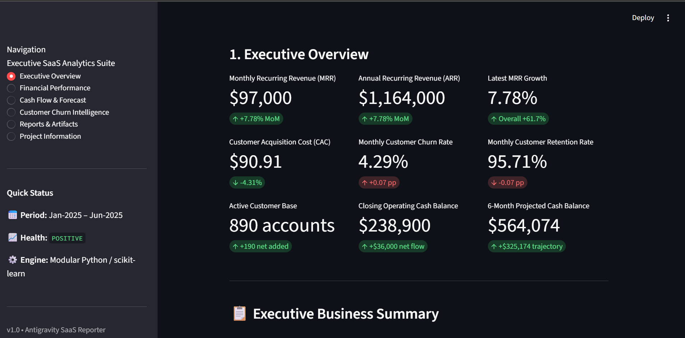
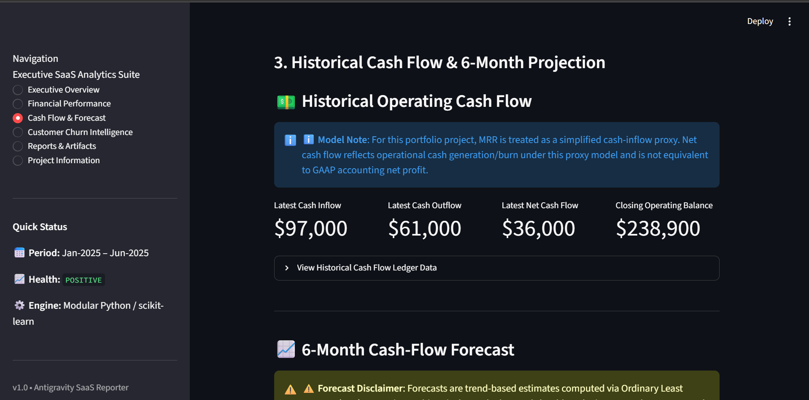

# SaaS Financial Reporter 📊

[](https://github.com/saxenaanirudha/saas-financial-reporter/actions/workflows/ci.yml)

An AI-assisted SaaS financial reporting and customer analytics system featuring recurring-revenue KPI analysis, cash-flow forecasting, automated PDF reporting, an interactive Streamlit dashboard, and machine-learning-based churn risk prediction.

> **Note on Datasets & Scope**: All financial and customer records used in this project are synthetic and illustrative, designed to simulate realistic subscription business dynamics without using proprietary data. This application is an internal management analytics and portfolio demonstration—not audited GAAP accounting software, a calibrated production churn system, or a multi-tenant SaaS service.

---

## ⚡ Quick Start

Compatible with **Python 3.9, 3.10, 3.11, and 3.12** (tested across GitHub Actions CI). For production deployments, using a currently supported Python version is recommended.

```bash
# 1. Clone the repository
git clone https://github.com/saxenaanirudha/saas-financial-reporter.git
cd saas-financial-reporter

# 2. Create and activate a virtual environment
# Windows PowerShell:
python -m venv .venv
.\.venv\Scripts\Activate.ps1

# macOS / Linux:
python3 -m venv .venv
source .venv/bin/activate

# 3. Install dependencies
python -m pip install -r requirements.txt

# 4. Run the automated reporting pipeline (computes KPIs, forecasts, PDF, and ML model)
python main.py

# 5. Launch the interactive browser presentation dashboard
streamlit run app.py
```

The pipeline initializes directories automatically and produces 17 runtime files across `charts/`, `reports/`, and `models/`. The Streamlit dashboard typically opens at `http://localhost:8501`.

---

## 🖥️ Dashboard Preview

The project includes an interactive Streamlit web dashboard providing a non-technical presentation layer for executives, investors, and team members to explore financial performance, cash trajectories, and customer risk scoring.

### Executive Overview & Financial Health


### Cash Flow & Forward Forecast


### Customer Churn Intelligence & ML Scoring


---

## 🌟 Key Highlights

- **MRR and ARR Analytics**: Computes Monthly Recurring Revenue (MRR) and Annualized Recurring Revenue (ARR) run-rates.
- **MRR Growth Analysis**: Measures Month-over-Month (MoM) revenue growth rates and net revenue expansions.
- **Customer Acquisition Cost (CAC)**: Tracks marketing spend efficiency per newly acquired subscriber.
- **Customer Churn & Retention Analysis**: Reconstructs customer counts chronologically to evaluate monthly subscriber churn and retention rates.
- **Historical Operating Cash-Flow Analysis**: Tracks monthly cash inflows against categorized operating expenses and rolls forward cash balances *(cash-flow tracking, not GAAP accounting profit)*.
- **6-Month Trend-Based Cash-Flow Forecasting**: Projects 6-month forward cash trajectories using component-by-component OLS linear regression *(trend-based projection, not guaranteed financial predictions)*.
- **Automated Management/Investor PDF Reporting**: Generates a multi-page, publication-grade executive PDF report with dynamic KPI tables and 10 embedded high-resolution charts via ReportLab.
- **Streamlit Browser Dashboard**: Interactive presentation interface (`streamlit run app.py`) for non-technical stakeholders to explore financial KPIs, cash-flow forecasts, churn intelligence, reports, and project architecture.
- **Customer-Level Churn Prediction using Logistic Regression**: End-to-end Scikit-Learn classification pipeline trained on separate customer behavioral data *(illustrative synthetic dataset; not claimed as production performance)*.
- **Actionable Churn-Risk Tiers**: Categorizes predicted customer churn probabilities into Low ($<0.30$), Medium ($0.30–0.60$), and High ($\ge 0.60$) risk segments for proactive retention outreach.
- **Automated Test Suite (203 Tests)**: 203 automated unit, integration, concurrency, and security regression tests passing cleanly across 16 test modules with 0 failures.
- **Barn Door Protocol Hardening**: Comprehensive security audit addressing spreadsheet formula injection, HMAC-SHA256 model provenance, thread-safe Matplotlib rendering, and atomic file persistence. Full audit trail documented in [`BARN_DOOR_QA_REPORT.md`](BARN_DOOR_QA_REPORT.md).
- **Multi-Version CI/CD Pipeline**: GitHub Actions matrix validating Python 3.9, 3.10, 3.11, and 3.12 on Ubuntu runners alongside end-to-end pipeline execution.

---

## 📖 Table of Contents
1. [Overview](#-overview)
2. [Business Problem](#-business-problem)
3. [Key Features](#-key-features)
4. [Interactive Streamlit Dashboard](#-interactive-streamlit-dashboard)
5. [Architecture](#-architecture)
6. [Project Structure](#-project-structure)
7. [Financial Dataset](#-financial-dataset)
8. [Customer Churn Dataset](#-customer-churn-dataset)
9. [Financial KPI Logic & Formulas](#-financial-kpi-logic--formulas)
10. [Historical Cash Flow Analysis](#-historical-cash-flow-analysis)
11. [Six-Month Cash Flow Forecasting](#-six-month-cash-flow-forecasting)
12. [Customer Churn Machine Learning](#-customer-churn-machine-learning)
13. [Generated Outputs & Artifacts](#-generated-outputs--artifacts)
14. [Installation & Setup](#-installation--setup)
15. [Running the Project](#-running-the-project)
16. [Running Tests](#-running-tests)
17. [Security & Quality Assurance — Barn Door Protocol](#-security--quality-assurance--barn-door-protocol)
18. [Example Workflow](#-example-workflow)
19. [Assumptions & Limitations](#-assumptions--limitations)
20. [AI-Assisted Development Approach](#-ai-assisted-development-approach)
21. [Skills Demonstrated](#-skills-demonstrated)
22. [Future Improvements](#-future-improvements)
23. [Disclaimer](#-disclaimer)

---

## 🎯 Overview

The **SaaS Financial Reporter** automates the periodic financial analysis and reporting workflow for a subscription-based business model. Built in Python, it integrates:
- **Core SaaS Metrics**: Monthly Recurring Revenue (MRR), Annual Recurring Revenue (ARR), MoM Revenue Growth, and Customer Acquisition Cost (CAC).
- **Customer Base Dynamics**: Roll-forward customer ledger reconstruction, monthly churn rates, and retention percentages.
- **Operating Cash Flow**: Inflow vs. multi-category outflow tracking, monthly net flow, and cumulative balance roll-forward.
- **Trend-Based Forecasting**: 6-month statistical forecasting of revenue and individual expense components using linear regression.
- **Automated Investor Reporting**: Generation of presentation-grade, multi-page PDF executive summaries with embedded high-resolution charts.
- **Interactive Web Interface**: A Streamlit browser application designed for non-technical stakeholders to interactively inspect financial performance and ML churn scoring.
- **Predictive Churn Risk Modeling**: A customer-level Machine Learning classification pipeline (Logistic Regression) that estimates churn probabilities and classifies accounts into actionable risk tiers.

---

## 💼 Business Problem

In early-stage and growing SaaS companies, monthly financial and customer reporting is frequently performed manually across disconnected spreadsheets. This manual workflow suffers from:
- **Repetitive Calculation Overhead**: Re-calculating MRR, ARR, CAC, and subscriber counts month after month.
- **Reporting Disconnect**: Financial metrics (revenue and cash) are rarely bridged with operational data (churn and usage).
- **Limited Forward Visibility**: Cash runways and expense trends are often projected using crude manual estimates.
- **Delayed Retention Intervention**: High-risk accounts are identified only after cancellations have already occurred.

This project demonstrates how a modular Python data pipeline can automate data validation, financial calculations, forecasting, chart rendering, PDF publication, interactive exploration, and predictive churn risk scoring in a unified, reproducible run.

> *Note: This project demonstrates reporting workflow automation and is not a substitute for audited accounting or professional financial advisory services.*

---

## 🚀 Key Features

### 1. Financial Performance & Revenue
- **MRR & ARR Tracking**: Computes monthly recurring revenue and annualized revenue run-rate.
- **Month-over-Month Growth**: Calculates MoM percentage expansion and net revenue additions.
- **Customer Acquisition Cost (CAC)**: Measures acquisition spend efficiency per new subscriber.

### 2. Subscriber Base & Retention Dynamics
- **Customer Base Roll-Forward**: Reconstructs opening, new, churned, and closing customer counts.
- **Churn & Retention Rates**: Calculates monthly subscriber churn rate % and retention rate % (safely handling initial baseline limitations).

### 3. Historical Cash Flow Analysis
- **Cash Inflow vs. Outflow**: Maps MRR inflows against marketing, operating, payroll, and administrative expenses.
- **Rolling Cash Ledger**: Computes monthly net cash flow and rolls forward closing cash balances.

### 4. Six-Month Cash Flow Forecasting
- **Component-by-Component OLS Regression**: Fits independent linear trend models on revenue and each expense line.
- **Non-Negative Clamping**: Revenue and expense lines are bounded at $\ge 0$ while allowing net cash flow and balances to fluctuate realistically.
- **Runway & Cash Trajectory**: Projects 6 months of forward closing balances and net cash burn.

### 5. Automated Management & Investor PDF Report
- **Multi-Page Executive Report**: Generates a publication-grade PDF using ReportLab with dynamic timestamps, KPI snapshot grids, financial statements, and 10 embedded high-resolution charts.

### 6. Interactive Presentation Dashboard (Streamlit)
- **Executive KPI Dashboard**: Live interactive cards, metric deltas, and responsive financial charts.
- **Cash Flow & Forecast Explorer**: Visual breakdown of historical cash flows, forward runway projections, and monthly expense structures.
- **Customer Churn Intelligence**: Real-time account risk filtering, feature importance explanations, and interactive risk tier distributions.
- **Reports & Artifact Viewer**: In-browser PDF report download, dataset inspectors, and system architecture summaries.

### 7. Customer-Level Churn Machine Learning Pipeline
- **Separate Behavioral Dataset**: Evaluates 500 customer records without contaminating aggregated financial data.
- **Scikit-Learn Pipeline**: Integrates `StandardScaler` (numerical), `OneHotEncoder` (categorical), and `LogisticRegression`.
- **Anti-Leakage Safeguards**: Preprocessing is fit strictly on training splits (`X_train`); identifiers and post-cancellation fields are excluded.
- **Actionable Risk Tiers**: Categorizes predicted probabilities into **Low** ($<0.30$), **Medium** ($0.30–0.60$), and **High** ($\ge 0.60$) risk segments.
- **Feature Importance**: Extracts learned coefficients and odds ratios to identify top churn risk drivers.

### 8. Reliability, Security & Orchestration
- **Pipeline Coordinator (`src/pipeline.py`)**: Drives end-to-end execution with decoupled stages.
- **Severity-Aware Error Handling**: Critical errors halt execution safely; non-critical failures log warnings and produce `PARTIAL_SUCCESS`.
- **Automatic Directory & Artifact Validation**: Auto-creates `charts/`, `reports/`, `models/` and verifies on-disk output integrity.
- **Barn Door Protocol Hardening**: Enterprise security controls protecting against CSV injection, pickle deserialization vulnerabilities, thread-safety figure corruption, and non-atomic writes.

---

## 🖥️ Interactive Streamlit Dashboard

To provide a non-technical, client-friendly presentation layer, the repository includes a Streamlit browser dashboard:

```powershell
streamlit run app.py
```

### Dashboard Capabilities:
- **Executive Overview**: High-level financial KPIs (MRR, ARR, CAC, churn rate, cash balance) with interactive month-over-month trend charts.
- **Cash Flow & Forecast**: Interactive breakdown of historical operating expenses, net cash flow, and 6-month linear forward projections.
- **Customer Churn Intelligence**: Exploration of customer churn risk tiers (Low, Medium, High), search and filtering across individual account profiles, and feature importance drivers.
- **Reports & Data Viewer**: In-browser inspection of raw datasets, generated metrics, and one-click download of the generated executive PDF report.
- **Architecture & Workflow**: Visual documentation of data flow, modeling assumptions, and engineering architecture.

---

## 🏛️ Architecture

```text
Monthly Financial Dataset (CSV)                 Customer-Level Churn Dataset (CSV)
             │                                                  │
             ▼                                                  ▼
     [ Data Ingestion ]                                 [ Data Ingestion ]
    (Schema & Range Check)                             (Schema & Target Check)
             │                                                  │
             ├──────────────────────┐                           ▼
             ▼                      ▼                   [ Stratified Split ]
   [ Revenue & CAC Engine ]   [ Cash Flow Engine ]      (80% Train / 20% Test)
             │                      │                           │
             ├──────────────────────┘                           ▼
             ▼                                          [ Pipeline Preprocessing ]
   [ Churn & Retention ]                               (StandardScaler + OneHotEncoder)
             │                                                  │
             ▼                                                  ▼
   [ Historical Comparison ]                            [ Logistic Regression ]
    (MoM & Baseline Trends)                            (Fit on Training Data Only)
             │                                                  │
             ▼                                                  ▼
   [ 10 Financial Charts ]                             [ Test Set Evaluation ]
   (Matplotlib Agg Engine)                             (Accuracy, F1, ROC-AUC, CM)
             │                                                  │
             ▼                                                  ▼
   [ 6-Month OLS Forecast ]                             [ Probability Scoring ]
   (Component Linear Trends)                           (Low / Med / High Risk Tiers)
             │                                                  │
             ▼                                                  ▼
   [ PDF Investor Report ]                             [ Churn Risk CSV & Charts ]
   (ReportLab Master File)                             (customer_churn_risk.csv)
             │                                                  │
             ├──────────────────────────────────────────────────┤
             ▼                                                  ▼
    [ Console Dashboard ]                              [ Streamlit Dashboard ]
   (CLI Summary Pipeline)                             (Browser Presentation Layer)
             │                                                  │
             └──────────────────────┬───────────────────────────┘
                                    │
                                    ▼
                     [ Pipeline Execution Summary ]
                    (Artifact Validation & Status)
```

---

## 📁 Project Structure

```text
saas-financial-reporter/
│
├── .github/
│   └── workflows/
│       └── ci.yml                     # Multi-version GitHub Actions CI/CD workflow (Python 3.9–3.12)
│
├── data/
│   ├── saas_financial_data.csv        # Aggregated monthly financial data (6 months)
│   ├── customer_churn_data.csv        # Synthetic customer-level churn data (500 records)
│   └── generate_churn_data.py         # Deterministic customer churn data generator
│
├── docs/
│   └── images/                        # Documentation and preview screenshots
│       ├── saas-executive-overview.png
│       ├── saas-cashflow.png
│       └── saas-customer-churn-intelligence.png
│
├── src/                               # Core application modules
│   ├── __init__.py
│   ├── config.py                      # Centralized path definitions and constants
│   ├── exceptions.py                  # Domain exception classes
│   ├── pipeline.py                    # Pipeline coordinator and orchestration engine
│   ├── security.py                    # Barn Door Protocol security, sanitization & integrity engine
│   ├── data_loader.py                 # Financial data loading and validation
│   ├── revenue_dashboard.py           # MRR, ARR, and revenue growth calculations
│   ├── cac_calculator.py              # Customer Acquisition Cost calculations
│   ├── churn_retention_analyzer.py    # Customer roll-forward, churn & retention metrics
│   ├── chart_generator.py             # Financial KPI and forecast chart generator
│   ├── kpi_comparator.py              # Historical period-over-period KPI comparisons
│   ├── cash_flow_analyzer.py          # Operating cash flow and rolling balance ledger
│   ├── cash_flow_forecaster.py        # 6-Month linear cash flow forecasting engine
│   ├── pdf_report_generator.py        # Automated investor/management PDF report
│   ├── reporting_dashboard.py         # Consolidated console reporting dashboard
│   └── churn_model.py                 # Logistic regression churn ML model & risk scoring
│
├── models/                            # Model output artifacts (runtime generated; ignored by Git)
│   ├── .gitkeep                       # Folder tracking
│   ├── churn_model.joblib             # Serialized trained scikit-learn pipeline
│   ├── churn_model_provenance.json    # Cryptographic HMAC-SHA256 provenance manifest
│   └── churn_model_metrics.json       # Serialized test evaluation metrics
│
├── charts/                            # Visual chart outputs (runtime generated; ignored by Git)
│   ├── .gitkeep                       # Folder tracking
│   ├── mrr_trend.png                  # MRR monthly trajectory
│   ├── arr_trend.png                  # ARR annualized trajectory
│   ├── cac_trend.png                  # Customer Acquisition Cost trajectory
│   ├── churn_retention_trend.png      # Churn & retention rate comparison
│   ├── customer_base_growth.png       # Active subscriber base growth
│   ├── mrr_growth_rate.png            # MoM MRR growth rate percentage
│   ├── net_cash_flow_trend.png        # Monthly net cash flow bars
│   ├── cash_balance_trend.png         # Closing cash balance trajectory
│   ├── cash_flow_forecast.png         # Historical vs 6-month net cash flow forecast
│   ├── cash_balance_forecast.png      # Historical vs 6-month cash balance forecast
│   ├── churn_confusion_matrix.png     # Churn ML confusion matrix heatmap
│   └── churn_roc_curve.png            # Churn ML ROC-AUC curve
│
├── reports/                           # Executive reports (runtime generated; ignored by Git)
│   ├── .gitkeep                       # Folder tracking
│   ├── saas_financial_report.pdf      # Master management/investor PDF report
│   └── customer_churn_risk.csv        # Sanitized customer accounts scored with risk tiers
│
├── tests/                             # Unit, integration & security test suite (203 passing tests)
│   ├── __init__.py
│   ├── test_app.py                    # Streamlit dashboard helper tests
│   ├── test_cac_calculator.py         # CAC calculation unit tests
│   ├── test_cash_flow_analyzer.py     # Cash flow ledger unit tests
│   ├── test_cash_flow_forecaster.py   # OLS linear forecasting tests
│   ├── test_chart_generator.py        # Chart generation tests
│   ├── test_churn_model.py            # Churn classification model tests
│   ├── test_churn_retention_analyzer.py # Subscriber roll-forward & churn tests
│   ├── test_concurrency.py            # Matplotlib thread safety & atomic write concurrency tests
│   ├── test_data_loader.py            # Schema validation and dataset ingestion tests
│   ├── test_end_to_end_regression.py  # End-to-end mathematical regression tests
│   ├── test_kpi_comparator.py         # Period-over-period comparison tests
│   ├── test_pdf_report_generator.py   # ReportLab PDF compilation tests
│   ├── test_pipeline.py               # Pipeline orchestration and error handling tests
│   ├── test_reporting_dashboard.py    # Console dashboard tests
│   ├── test_revenue_dashboard.py      # MRR, ARR, and growth rate tests
│   └── test_security.py               # OWASP & Barn Door Protocol security regression tests
│
├── app.py                             # Interactive Streamlit browser dashboard
├── main.py                            # Automated pipeline CLI entry point
├── requirements.txt                   # Project dependencies with PEP 508 Python version markers
├── .gitignore                         # Git ignore configuration (excludes runtime artifacts)
├── BARN_DOOR_QA_REPORT.md             # Formal Barn Door Protocol security & QA audit report
├── PROJECT_SUMMARY.md                 # Project architecture & quick reference
├── GITHUB_DESCRIPTION.txt             # Repository description & topic tags
├── RESUME_PROJECT_ENTRY.md            # Resume & portfolio snippets
├── INTERVIEW_QA.md                    # 20 technical & domain interview Q&As
└── README.md                          # Comprehensive technical documentation
```

---

## 📊 Financial Dataset

The financial pipeline reads from `data/saas_financial_data.csv`. This dataset represents 6 consecutive months of operating metrics for an illustrative SaaS business:

| Column | Type | Description | Example |
| :--- | :--- | :--- | :--- |
| `Month` | String | Calendar month label (`%b-%Y`) | `Jan-2025` |
| `NewCustomers` | Integer | New subscriber additions acquired during the month | `105` |
| `ChurnedCustomers` | Integer | Existing subscriber accounts cancelled during the month | `0` |
| `MRR` | Float | Total Monthly Recurring Revenue recognized | `60000.0` |
| `MarketingSpend` | Float | Marketing & customer acquisition expenditure | `15000.0` |
| `OperatingExpenses` | Float | Software tools, cloud hosting, and infrastructure costs | `12000.0` |
| `PayrollExpenses` | Float | Team salaries, contractor fees, and compensation | `20000.0` |
| `OtherExpenses` | Float | Legal, administrative, and miscellaneous expenses | `3000.0` |

> *All financial records are synthetic illustrative data designed to demonstrate pipeline functionality.*

---

## 👥 Customer Churn Dataset

The Machine Learning classification model reads from `data/customer_churn_data.csv`. This customer-level dataset contains 500 individual account records:

| Feature | Type | Description |
| :--- | :--- | :--- |
| `CustomerID` | String | Unique customer identifier (excluded from training) |
| `SignupDate` | String | Account creation date (excluded from training) |
| `Plan` | Categorical | Subscription plan tier (`Basic`, `Pro`, `Enterprise`) |
| `MonthlyFee` | Float | Contracted monthly recurring fee ($) |
| `TenureMonths` | Integer | Total active tenure in months |
| `LastLoginDaysAgo` | Integer | Recency of last product login (days) |
| `SupportTickets` | Integer | Number of customer support inquiries filed |
| `MonthlyUsageHours`| Float | Total platform engagement time in the past month (hours) |
| `PaymentFailures` | Integer | Number of recurring billing failures encountered |
| `DiscountPercent` | Float | Discount percentage applied to subscription |
| `ContractType` | Categorical | Contract term (`Monthly` vs. `Annual`) |
| `AutoRenew` | Binary | Automatic renewal status (`1` = Active, `0` = Disabled) |
| `Churned` | Binary | Target variable (`1` = Churned, `0` = Active) |

### Why Separate Datasets?
- **Aggregated Financial Data (`data/saas_financial_data.csv`)** operates at the monthly cohort level, providing top-down financial and cash flow visibility.
- **Customer-Level Data (`data/customer_churn_data.csv`)** captures granular behavioral interactions required for individualized risk modeling without creating artificial joins.

---

## 📐 Financial KPI Logic & Formulas

### 1. Monthly Recurring Revenue (MRR) & Annual Recurring Revenue (ARR)
$$\text{MRR} = \text{Monthly Subscription Revenue Recognized}$$
$$\text{ARR} = \text{MRR} \times 12$$

*Note: ARR represents an annualized run-rate based on current monthly pace, not a guaranteed projection of realized 12-month future revenue.*

### 2. Month-over-Month MRR Growth Rate
$$\text{MoM Growth } (\%) = \frac{\text{MRR}_t - \text{MRR}_{t-1}}{\text{MRR}_{t-1}} \times 100$$
*(First month growth is explicitly undefined / `NaN` due to lack of a preceding baseline; zero-denominator scenarios are guarded).*

### 3. Customer Acquisition Cost (CAC)
$$\text{CAC} = \frac{\text{Marketing Spend}}{\text{New Customers Acquired}}$$
*(Returns `NaN` when new customers acquired equals 0 to prevent division-by-zero errors).*

### 4. Reconstructed Customer Base Roll-Forward
Because monthly aggregated data lacks explicit beginning balance records, the subscriber base is reconstructed chronologically:
- **Month 1 Beginning Customers**: Initialized to `0`.
- **Ending Customers**: $\text{Beginning Customers} + \text{New Customers} - \text{Churned Customers}$
- **Month $N$ Beginning Customers**: $\text{Ending Customers}_{N-1}$

*Note: Customer Lifetime Value (LTV) and an explicit initial opening customer base parameter were deferred in the baseline protocol; the reconstructed base is an illustrative roll-forward.*

### 5. Customer Churn Rate & Retention Rate
$$\text{Churn Rate } (\%) = \frac{\text{Churned Customers}_t}{\text{Beginning Customers}_t} \times 100$$
$$\text{Retention Rate } (\%) = 100 - \text{Churn Rate } (\%)$$
*(First month churn/retention is recorded as `NaN` because Month 1 beginning customer base is initialized to 0).*

---

## 💵 Historical Cash Flow Analysis

The cash flow module models operational liquidity under a transparent simplified cash ledger:

1. **Cash Inflow**: Modeled directly as Monthly Recurring Revenue ($\text{Cash Inflow} = \text{MRR}$).
2. **Total Operating Cash Outflow**:
   $$\text{Total Outflow} = \text{MarketingSpend} + \text{OperatingExpenses} + \text{PayrollExpenses} + \text{OtherExpenses}$$
3. **Net Cash Flow**:
   $$\text{Net Cash Flow} = \text{Cash Inflow} - \text{Total Outflow}$$
4. **Cash Balance Roll-Forward**:
   - $\text{Month 1 Opening Balance} = \$100,000 \text{ (Default configured baseline)}$
   - $\text{Closing Balance}_t = \text{Opening Balance}_t + \text{Net Cash Flow}_t$
   - $\text{Opening Balance}_{t+1} = \text{Closing Balance}_t$

> **Important Distinction**: Operating cash flow represents liquidity movement through the business and is distinct from GAAP accounting profit (which requires accounting for revenue deferrals, receivables aging, depreciation, and amortization).

---

## 🔮 Six-Month Cash Flow Forecasting

To estimate future cash burn and runway without opaque assumptions, the forecaster fits independent Ordinary Least Squares (OLS) linear trend models on historical monthly series ($t = 1 \dots N$):

1. **Component Trend Models**:
   - $\widehat{\text{Inflow}}(t) = \beta_0^{\text{in}} + \beta_1^{\text{in}} t$
   - $\widehat{\text{Marketing}}(t) = \beta_0^{\text{mkt}} + \beta_1^{\text{mkt}} t$
   - $\widehat{\text{Operating}}(t) = \beta_0^{\text{ops}} + \beta_1^{\text{ops}} t$
   - $\widehat{\text{Payroll}}(t) = \beta_0^{\text{pay}} + \beta_1^{\text{pay}} t$
   - $\widehat{\text{Other}}(t) = \beta_0^{\text{oth}} + \beta_1^{\text{oth}} t$
2. **Non-Negative Clamping**:
   $$\widehat{\text{Component}}(t) = \max(0, \widehat{\text{Component}}(t))$$
3. **Derived Totals**:
   $$\widehat{\text{Total Outflow}}(t) = \sum \widehat{\text{Expenses}}(t)$$
   $$\widehat{\text{Net Cash Flow}}(t) = \widehat{\text{Inflow}}(t) - \widehat{\text{Total Outflow}}(t)$$
4. **Projected Balance Roll-Forward**:
   The first forecast month opens with the latest historical closing cash balance and rolls forward across the 6 projected months.

> **Forecasting Nature**: Given the 6-month historical series, these projections represent linear trend extrapolations for scenario planning, not statistical prediction intervals or guaranteed future financial outcomes.

---

## 🤖 Customer Churn Machine Learning

### ML Pipeline Workflow
1. **Stratified Split**: 80% Training / 20% Testing (`stratify=y`, `random_state=42`).
2. **ColumnTransformer Preprocessing**:
   - **Numerical Features** (`StandardScaler`): `MonthlyFee`, `TenureMonths`, `LastLoginDaysAgo`, `SupportTickets`, `MonthlyUsageHours`, `PaymentFailures`, `DiscountPercent`, `AutoRenew`.
   - **Categorical Features** (`OneHotEncoder(drop='first', handle_unknown='ignore')`): `Plan`, `ContractType`.
3. **Classifier**: `LogisticRegression(max_iter=1000, random_state=42)`.
4. **Evaluation**: Held-out test set metrics computed with `zero_division=0` and exported to `models/churn_model_metrics.json`:
   - Accuracy, Precision, Recall, F1-Score, ROC-AUC Score, and Confusion Matrix ($TN, FP, FN, TP$).

> **Model Performance Note**: Inspect `models/churn_model_metrics.json` directly for the exact evaluation metrics of your run. Metrics on synthetic illustrative data demonstrate pipeline execution and do not represent production performance on live customer telemetry.

### Operational Risk Tiers
Predicted probabilities $P(\text{Churn} = 1)$ are mapped to portfolio action tiers:

| Tier | Predicted Probability | Operational Guidance |
| :--- | :--- | :--- |
| **Low Risk** | $P < 0.30$ | Account healthy; standard lifecycle engagement |
| **Medium Risk** | $0.30 \le P < 0.60$ | Moderate engagement decline; automated check-ins |
| **High Risk** | $P \ge 0.60$ | Elevated churn probability; prioritized for Customer Success outreach |

*Note: These tiers represent illustrative operational heuristics rather than cost-calibrated retention policies.*

### Data Leakage Protections
- Preprocessing transformations are fit strictly on `X_train` inside the scikit-learn `Pipeline`.
- Non-predictive identifiers (`CustomerID`) and timestamp columns (`SignupDate`) are dropped before fitting.

---

## 📁 Generated Outputs & Artifacts

When `python main.py` executes, it produces **17 files on disk** across three output directories. The pipeline coordinator validates **16 primary business reporting artifacts** during Step 14, while the model serialization engine atomically writes the accompanying **cryptographic provenance manifest** (`churn_model_provenance.json`):

| # | Artifact | File Path | Category | Role & Description |
| :-: | :--- | :--- | :--- | :--- |
| 1 | **PDF Investor Report** | `reports/saas_financial_report.pdf` | Reporting | Multi-page executive summary with KPI tables and 10 embedded charts |
| 2 | **Customer Risk Report** | `reports/customer_churn_risk.csv` | Analytics | 500 accounts scored with churn probability and risk tier (formula-sanitized) |
| 3 | **MRR Trend Chart** | `charts/mrr_trend.png` | Financial Chart | Monthly recurring revenue historical progression plot |
| 4 | **ARR Trend Chart** | `charts/arr_trend.png` | Financial Chart | Annualized recurring revenue run-rate progression plot |
| 5 | **CAC Trend Chart** | `charts/cac_trend.png` | Financial Chart | Customer acquisition cost trajectory and spend efficiency plot |
| 6 | **Churn & Retention Chart** | `charts/churn_retention_trend.png` | Financial Chart | Monthly customer churn % vs. retention % comparison plot |
| 7 | **Customer Base Growth Chart**| `charts/customer_base_growth.png` | Financial Chart | Reconstructed active subscriber base growth plot |
| 8 | **MRR Growth Rate Chart** | `charts/mrr_growth_rate.png` | Financial Chart | Month-over-month percentage revenue expansion plot |
| 9 | **Net Cash Flow Chart** | `charts/net_cash_flow_trend.png` | Financial Chart | Historical monthly net operational cash flow bars |
| 10 | **Cash Balance Chart** | `charts/cash_balance_trend.png` | Financial Chart | Cumulative closing cash balance ledger trajectory plot |
| 11 | **Cash Flow Forecast Chart** | `charts/cash_flow_forecast.png` | Financial Chart | Historical vs. 6-month projected net cash flow comparison |
| 12 | **Cash Balance Forecast Chart**| `charts/cash_balance_forecast.png`| Financial Chart | Historical vs. 6-month projected closing cash balance comparison |
| 13 | **Churn Confusion Matrix** | `charts/churn_confusion_matrix.png`| ML Evaluation | Test set classification performance heatmap ($TN, FP, FN, TP$) |
| 14 | **Churn ROC Curve** | `charts/churn_roc_curve.png` | ML Evaluation | Receiver Operating Characteristic plot with computed ROC-AUC score |
| 15 | **Churn Model Binary** | `models/churn_model.joblib` | ML Model | Serialized scikit-learn trained classification pipeline |
| 16 | **Churn Metrics JSON** | `models/churn_model_metrics.json` | ML Evaluation | Structured evaluation metrics (accuracy, precision, recall, F1, AUC) |
| 17 | **Model Provenance Manifest** | `models/churn_model_provenance.json`| Security | HMAC-SHA256 signature, SHA-256 hash, and metadata for artifact integrity and authenticity verification |

*Note: All runtime output files are excluded from version control via `.gitignore`. Running `python main.py` regenerates all 17 artifacts cleanly.*

---

## 🛠️ Installation & Setup

### 1. Prerequisites
- **Python 3.9, 3.10, 3.11, or 3.12**
- Git

### 2. Clone the Repository
```powershell
git clone https://github.com/saxenaanirudha/saas-financial-reporter.git
cd saas-financial-reporter
```

### 3. Create & Activate Virtual Environment
**Windows PowerShell:**
```powershell
python -m venv .venv
.\.venv\Scripts\Activate.ps1
```

**macOS / Linux:**
```bash
python3 -m venv .venv
source .venv/bin/activate
```

### 4. Install Dependencies
```powershell
python -m pip install -r requirements.txt
```

> **Note on ReportLab & Python 3.9**: Upstream `reportlab 5.1.0+` dropped support for Python 3.9. The repository's `requirements.txt` includes PEP 508 environment markers (`reportlab>=4.0.0,<5.1.0; python_version < "3.10"`) ensuring full compatibility across Python 3.9 through 3.12 without manual intervention.

---

## 🏃 Running the Project

### 1. Run the Automated Analytics & ML Pipeline
To execute the complete end-to-end reporting pipeline:

```powershell
python main.py
```

#### What Happens During Pipeline Execution:
1. Output directories (`charts/`, `reports/`, `models/`) are initialized automatically.
2. Monthly financial data (`data/saas_financial_data.csv`) is validated and loaded.
3. Revenue, CAC, and Churn/Retention analytics are computed.
4. Historical cash flow and 6-month statistical forecasts are generated.
5. High-resolution PNG charts and master PDF report (`reports/saas_financial_report.pdf`) are rendered atomically.
6. Consolidated console dashboard displays core business health.
7. Customer churn dataset (`data/customer_churn_data.csv`) is split and trained via Logistic Regression.
8. Customer risk report (`reports/customer_churn_risk.csv`), model binary, and signed HMAC provenance manifest are persisted.
9. Final artifact validation verifies all 16 business artifacts on disk.

### 2. Launch the Interactive Presentation Dashboard
To launch the client-ready Streamlit web application:

```powershell
streamlit run app.py
```

The dashboard will open automatically in your default browser (typically at `http://localhost:8501`), providing a visual, interactive interface to explore all financial KPIs, runway forecasts, customer risk segments, and generated PDF reports.

---

## 🧪 Running Tests

The test suite contains **203 automated unit, integration, concurrency, and security regression tests** passing cleanly across 16 test modules with 0 failures:

```powershell
# Verbose test execution (runs all 203 tests across 16 test modules)
pytest -v

# Quiet summary check
pytest -q
```

### Continuous Integration (GitHub Actions)
The repository uses a multi-version CI workflow (`.github/workflows/ci.yml`) validating all changes against:
- **Unit Tests (Python 3.9)**: Pinned `ubuntu-22.04` runner with ReportLab compatibility constraint.
- **Unit Tests (Python 3.10)**: Pinned `ubuntu-22.04` runner.
- **Unit Tests (Python 3.11)**: Pinned `ubuntu-22.04` runner.
- **Unit Tests (Python 3.12)**: Pinned `ubuntu-22.04` runner.
- **End-to-End Pipeline Validation (Python 3.12)**: Full pipeline execution producing all 16 business artifacts and uploading chart and PDF bundles.

---

## 🛡️ Security & Quality Assurance — Barn Door Protocol

The project has undergone rigorous application security auditing and engineering hardening following the **Barn Door Protocol**, achieving a **PASS (RELEASE READY)** verdict with **203 automated tests passing cleanly** across 16 test modules. Full methodology, vulnerability analysis, and behavioral TDD verification evidence are documented in [`BARN_DOOR_QA_REPORT.md`](BARN_DOOR_QA_REPORT.md).

### Key Security & Reliability Mitigations:

- **Spreadsheet Formula Injection Prevention (CWE-1236 / SEC-01 & BLK-02):**
  Defensively sanitizes string exports in `sanitize_dataframe_for_csv()`. Cells starting with formula triggers (`=`, `+`, `-`, `@`, `\t`, `\r`) — including values preceded by whitespace, spaces, tabs, or newlines (`" =cmd|..."`, `"\t+1234"`, `"\n-cmd"`) — are safely prefixed with a single quote (`'`). Already quoted cells (`'`) are preserved without double-escaping, and native numeric columns (`float`, `int`, e.g., negative cash flows `-1500.50`) remain untransformed.
- **HMAC-SHA256 Model Provenance Verification (CWE-502 / SEC-02 & BLK-01):**
  Serialized scikit-learn model artifacts (`churn_model.joblib`) are paired with a cryptographically signed HMAC-SHA256 provenance manifest (`churn_model_provenance.json`). Deserialization verifies file size bounds (50 MB safety cap), path containment (preventing directory traversal attacks), SHA-256 binary hash, and HMAC signature prior to unpickling. This cryptographic verification provides essential artifact integrity and authenticity checks to prevent unauthorized replacement or tampering; however, it does not make pickle/joblib deserialization inherently safe against arbitrary execution if an untrusted artifact is signed. Only model artifacts from trusted sources should ever be loaded.
- **Production Key Management & Rotation (BLK-01):**
  Hardcoded fallback signing keys are strictly rejected. In production/strict mode (`require_secret=True`, `SAAS_STRICT_SECURITY=1`, or `SAAS_ENV=production`), a missing `SAAS_MODEL_SECRET` raises `SecurityValidationError` without exposing key bytes in logs. In local development and CI workflows, an ephemeral process-isolated random secret (`os.urandom(32)`) is generated in memory, preventing signature forgery against static keys while enabling test suites to run unhindered.
- **Thread-Safe Matplotlib Rendering (CONC-01 / BLK-03):**
  100% of Matplotlib operations across `src/chart_generator.py`, `src/churn_model.py` (confusion matrix & ROC curve), and `app.py` (risk distribution & feature impact bar charts) are synchronized under `MATPLOTLIB_LOCK` via `@thread_safe_chart`. All `plt.close()` calls are protected within the locked context to prevent cross-session figure bleeding and state corruption during concurrent multi-user Streamlit sessions.
- **Atomic File Persistence (CONC-02 / BLK-04):**
  Model binaries and provenance manifests are staged via temporary files and committed using atomic `os.replace` under `ARTIFACT_PUBLISH_LOCK` (`atomic_publish_model_and_provenance`). Customer risk CSV exports and metrics JSON are written atomically via `atomic_write_bytes()`. ReportLab PDF compilation writes to temporary files before atomic commitment, eliminating torn writes or corrupted outputs during pipeline execution.
- **ReportLab PDF XML Entity Escaping (CWE-116 / SEC-03):**
  All dynamic data, table cells, headers, and narrative summaries injected into ReportLab PDF flowables are sanitized via `safe_xml_escape()` (`&`, `<`, `>`, `"`, `'`), preventing XML parsing crashes.
- **Resource Exhaustion & Denial of Service Protection (CWE-400 / SEC-05):**
  Input datasets are strictly bounded to prevent memory exhaustion (financial data capped at 10,000 rows; churn data capped at 500,000 rows).
- **Sanitized Error Handling (CWE-209 / SEC-04):**
  User-facing UI exception handlers log technical stack traces to server event logs while displaying clean, sanitized error banners to prevent system path disclosure.

### Secure Production Secret Configuration:

To enforce strict cryptographic provenance in production environments, configure `SAAS_MODEL_SECRET` via environment variables or a secret vault:

```bash
# Linux / macOS (bash / zsh)
export SAAS_MODEL_SECRET="<your-strong-random-hex-secret-min-32-chars>"
export SAAS_STRICT_SECURITY=1

# Windows (PowerShell)
$env:SAAS_MODEL_SECRET="<your-strong-random-hex-secret-min-32-chars>"
$env:SAAS_STRICT_SECURITY="1"
```

> **Key Rotation**: To rotate the signing key, update `SAAS_MODEL_SECRET` in your environment, retrain the model via `python main.py`, and re-publish the newly signed provenance manifest. Never commit or log signing keys.

### Verified Protections vs. Documented Limitations:

| Dimension | Verified Protections | Documented Limitations |
| :--- | :--- | :--- |
| **Concurrency Scope** | Multi-threaded safety within a single process via `MATPLOTLIB_LOCK` and `ARTIFACT_PUBLISH_LOCK`. | Multi-process model/manifest publication uses individual atomic `os.replace` calls. While individual file replacements are OS-atomic, mutual transactionality across separate operating system processes requires an external distributed lock. |
| **Application Scope** | Secure internal management reporting and analytical dashboarding. | Single-tenant architecture. Streamlit's process-global caching is designed for single-tenant internal use and must be partitioned before handling multi-tenant private data. |
| **Data Scope** | Tested against malicious formula injection, XML payloads, and oversized datasets. | CSV formula escaping applies `'` prefixing; consumer behavior can vary across spreadsheet software versions and import settings. Cash flow treats MRR as immediate inflow without accounts receivable aging. |
| **Model Deserialization** | HMAC-SHA256 signature and SHA-256 hash verified before `joblib.load()`. | Cryptographic provenance provides artifact integrity and authenticity verification against unauthorized replacement or tampering, but does not make pickle/joblib deserialization inherently safe. Only trusted model artifacts should be loaded. |

---

## 🔄 Example Workflow

1. **Update Financial Data**: Place updated monthly figures into `data/saas_financial_data.csv`.
2. **Execute Pipeline**: Run `python main.py`.
3. **Inspect Console Dashboard**: Review executive revenue summary, MoM KPI movements, and overall status.
4. **Open PDF Report**: Open `reports/saas_financial_report.pdf` for executive or investor review.
5. **Review At-Risk Accounts**: Open `reports/customer_churn_risk.csv` to review high-probability churn accounts for proactive intervention.
6. **Explore in Browser**: Run `streamlit run app.py` to present insights interactively.

---

## ⚠️ Assumptions & Limitations

- **Synthetic Datasets**: Both the financial dataset (6 months) and customer churn dataset (500 records) are illustrative synthetic data created for portfolio demonstration.
- **Simplified Cash Flow Ledger**: Cash inflow is modeled directly from MRR without tracking deferred revenue, accounts receivable aging, or billing timing differences. Operating cash flow is not GAAP accounting profit.
- **Linear Trend Forecasting**: OLS trend forecasting assumes historical growth patterns continue; it represents planning scenarios and does not guarantee future financial outcomes or model macroeconomic shocks.
- **Customer Base Reconstruction**: Aggregate historical subscriber counts are reconstructed chronologically assuming Month 1 begins with 0 customers.
- **Model Portfolio Scope**: The churn classification model demonstrates a clean ML workflow and is not calibrated for live automated production decisioning without real product telemetry.

---

## 🤖 AI-Assisted Development Approach

This project was developed using an **AI-assisted software engineering workflow**. AI tools supported implementation, boilerplate generation, and debugging, while project direction was focused on core business requirements, financial logic formulation, statistical methodology, rigorous test coverage, and end-to-end workflow integration.

The primary objective of this project was to construct a transparent, production-style analytics and reporting lifecycle—from raw data validation and financial mathematics to machine learning integration, test-driven quality assurance, and interactive presentation—ensuring every formula, edge case, and architectural decision is transparent, interview-defensible, and thoroughly validated.

---

## 🛠️ Skills Demonstrated

- **Financial Analytics & SaaS Unit Economics**: MRR, ARR, CAC, MoM revenue growth, subscriber churn rate, and customer base roll-forwards.
- **Cash Flow Modeling & Forecasting**: Multi-category expense tracking, net cash flow calculation, and OLS linear trend forecasting.
- **Machine Learning & Predictive Modeling**: Scikit-Learn pipelines, `ColumnTransformer`, `StandardScaler`, `OneHotEncoder`, `LogisticRegression`, and risk stratification.
- **Data Leakage Awareness**: Training/test split discipline, transformer fitting isolation, and identifier exclusion.
- **Automated Document & Chart Generation**: Multi-page PDF generation via ReportLab and publication-grade Matplotlib visualizations.
- **Interactive Web Development**: Streamlit dashboard presentation layer with caching and modular data connectivity.
- **Robust Software Engineering**: Decoupled architecture, domain exceptions, input DataFrame immutability, automated directory preparation, and artifact validation.
- **Test-Driven Quality Assurance**: 203 comprehensive unit, integration, and security regression tests using `pytest`.
- **CI/CD Automation**: GitHub Actions multi-version Python test matrix (Python 3.9–3.12) and artifact upload workflows.
- **Application Security & Hardening**: Defense-in-depth against CSV formula injection (CWE-1236), unsafe deserialization (CWE-502), XML entity injection (CWE-116), path exposure (CWE-209), and resource exhaustion (CWE-400).

---

## 🔮 Future Improvements

- **Extended Historical Data**: Incorporate multi-year financial history to support seasonal ARIMA / Holt-Winters forecasting.
- **Cohort Retention Heatmaps**: Build triangle cohort retention matrices tracking subscriber longevity over time.
- **Threshold Calibration**: Implement cost-sensitive threshold optimization based on Customer Lifetime Value (LTV) vs. retention outreach cost.
- **Database Integration**: Connect ingestion pipelines to PostgreSQL or cloud data warehouses (BigQuery/Snowflake).
- **Cross-Process Publication Locking**: Integrate distributed advisory locking for multi-process environments requiring cross-file transactional publication.

---

## ⚖️ Disclaimer

This project uses synthetic portfolio data and simplified financial and machine learning assumptions. It is designed solely for educational, portfolio, and demonstration purposes. It does not constitute investment advice, audited financial accounting, or production-ready decisioning software.
